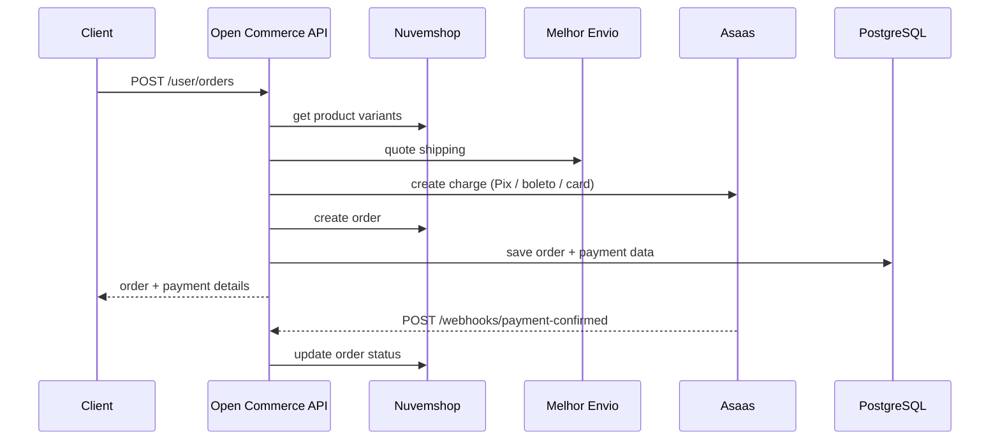

# Open Commerce API

Headless checkout API built with NestJS on top of a **Nuvemshop** store: products come from Nuvemshop, shipping is quoted with **Melhor Envio**, payments are processed by **Asaas** (Pix, boleto or credit card with installments), and a webhook confirms the payment and updates the order.

## Highlights

- **Checkout flow** – Fetches the product variants, quotes shipping, calculates the total (with interest on installments above 3x), creates the charge on Asaas and the order on Nuvemshop, then stores everything in PostgreSQL.
- **Payments** – Pix (QR code), boleto (digitable line) and credit card with installments.
- **Webhook** – `POST /webhooks/payment-confirmed` validates the Asaas access token and the customer before marking the order as paid on Nuvemshop.
- **Integrations** – Asaas, Nuvemshop, Melhor Envio, ViaCEP (address lookup) and Mailgun (transactional email with EJS templates).
- **Auth** – JWT with `USER` and `ADMIN` roles.
- **Database** – PostgreSQL with TypeORM migrations.
- **Error handling** – Global validation pipe and exception filters for HTTP, TypeORM and not-found errors.
- **CI/CD** – GitHub Actions runs ESLint and Prettier, builds the app and deploys to Vercel.

## Checkout flow



## Stack

NestJS · TypeScript · PostgreSQL · TypeORM · JWT · Swagger · Jest · Docker · GitHub Actions · Vercel

## Main endpoints

| Method | Route | Description |
| --- | --- | --- |
| `POST` | `/session/signin` | Login |
| `GET` | `/products`, `/products/:id` | Products from Nuvemshop |
| `POST` | `/orders/estimate/shipping` | Shipping quote |
| `POST` | `/orders/estimate/installments` | Installment simulation |
| `POST` | `/user/orders` | Create order and payment |
| `GET` | `/user/orders`, `/user/orders/:id` | User orders |
| `GET` | `/user/orders/:id/check-status` | Payment status |
| `POST` | `/webhooks/payment-confirmed` | Asaas payment webhook |
| `GET` | `/via-cep/:postalCode` | Address lookup |
| `*` | `/admin/users`, `/user/users` | User management |

Swagger UI: `http://localhost:3000/docs`

## Running locally

```bash
cp .env.example .env      # fill in database and provider credentials
docker compose up -d      # PostgreSQL + pgAdmin (:5050)
npm install
npm run migration:run
npm run start:dev
```

## Tests

```bash
npm run test       # unit tests (Nuvemshop, Melhor Envio and ViaCEP services have mocked HTTP tests)
npm run test:cov
```

---

Built by [Silas Santos](https://github.com/silasoli) · [LinkedIn](https://www.linkedin.com/in/silasoli/)
